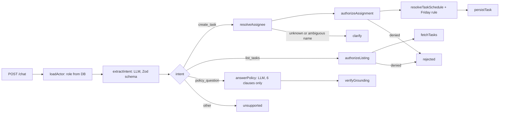

# مساعد المهام الذكي — Smart Task Assistant

An Arabic assistant (MSA and Saudi dialect) that reads an employee's message, then **creates a task**, **lists tasks**
or **answers from the company policy**, all under real role-based permissions enforced in code and in the database.

Built with **Next.js 15**, **LangGraph.js**, **LangSmith**, **OpenAI `gpt-4.1-mini`** and **MongoDB** (official Node driver).

> بوت يقرأ رسالة الموظف بالعربي، فيسجّل المهمة أو يعرضها أو يجاوب من سياسة الشركة — وكل ذلك تحت صلاحيات حقيقية
> تُطبّق في الكود وقاعدة البيانات، لا في تعليمات النموذج.

---

## Quick start (two commands)

Requirements: Node.js ≥ 20.9, pnpm (`corepack enable`) and a MongoDB database (e.g. a free MongoDB Atlas cluster).

```bash
cp .env.example .env        # then put OPENAI_API_KEY and MONGODB_URI (and optionally LANGSMITH_API_KEY) in .env
pnpm install && pnpm dev    # http://localhost:3000
```

The collections (with their validators) are created in `MONGODB_DB` and seeded with the six employees automatically
on the first request.

## Running the ten test messages (T01–T10)

| Way | Command |
|---|---|
| Terminal (recommended for review) | `pnpm scenarios`: resets the DB, runs T01–T10 in order, prints PASS/FAIL per message, writes [`docs/scenario-results.md`](docs/scenario-results.md) |
| Against the running server | `pnpm scenarios --url http://localhost:3000` |
| Browser | Open http://localhost:3000 and click **تشغيل الكل** |
| curl | see below |

```bash
curl -s -X POST http://localhost:3000/chat \
  -H 'Content-Type: application/json' \
  -d '{"user_id": 2, "message": "سجل مهمة لخالد بكرة الساعة 10 يراجع عرض السعر"}'
```

```json
{
  "action": "create_task",
  "task_id": 1,
  "reply": "تم، أسندت المهمة رقم 1 إلى خالد: «يراجع عرض السعر» — الأربعاء 14 أكتوبر 2026 الساعة 10:00 صباحاً.",
  "task": { "id": 1, "assigneeId": 4, "assigneeName": "خالد", "dueDate": "2026-10-14", "dueTime": "10:00", "movedFromDate": null, "...": "..." },
  "run_id": "…LangSmith trace id…"
}
```

## API

### `POST /chat` (R1)

Request: `{ "user_id": number, "message": string }`

Response: `{ "action", "task_id", "reply", ...details }`

| `action` | Meaning | Extra fields |
|---|---|---|
| `create_task` | Task created | `task_id`, `task` |
| `list_tasks` | Tasks the sender is allowed to see | `tasks` |
| `answer_policy` | Answer taken from the policy text | `sources` (cited clauses, verbatim) |
| `info_not_available` | The policy does not contain the answer | — |
| `clarify` | Bot needs more information (unknown name, missing date, …) | `reason` |
| `rejected` | Not permitted for the sender's role | `reason` |
| `error` | Technical error (HTTP 500) | — |

Every response carries `run_id`, the id of the LangSmith trace and of the audit-log entry.

### Helper endpoints

- `GET /audit?user_id=1`: the audit log (manager only, otherwise 403).
- `GET /api/tasks?user_id=…`: all tasks visible to that user (used by the UI side panel).
- `POST /api/reset`: wipes tasks and the log (demo only; requires `ENABLE_DEMO_RESET=true`).

## Architecture



**The LLM is only a parser.** It converts the message into a typed intent: who, what, a *description* of when
("tomorrow", "Friday", "asr"), and which scope to list. Everything else is deterministic TypeScript working on
database rows:

- role and identity (from the DB by `user_id`)
- permission decisions
- name lookup (exact normalized match, no guessing)
- date arithmetic in `Asia/Riyadh` and the Friday rule
- reply wording (templates)

The LangGraph graph (`lib/agent/graph.ts`) makes each of those steps a node, so each one shows up as a separate step in
the LangSmith trace.

## Where permissions are enforced (R3)

Permissions are enforced in **four layers**. None of them reads the role from the message or relies on the prompt.

| # | Layer | Code |
|---|---|---|
| 1 | The sender's role is loaded from the database by `user_id` | [`lib/agent/nodes/common.ts`](lib/agent/nodes/common.ts) (`loadActor`, line 6) |
| 2 | Policy functions decide assign/list rights | [`lib/auth/permissions.ts`](lib/auth/permissions.ts): `canAssign` (l. 21), `visibilityScope` (l. 36), `canList` (l. 58); called from [`nodes/create-task.ts`](lib/agent/nodes/create-task.ts) (l. 31, 54) and [`nodes/list-tasks.ts`](lib/agent/nodes/list-tasks.ts) (l. 32, 40, 57) |
| 3 | The repository re-checks and always applies the actor's scope in the MongoDB query | [`lib/repo/tasks.ts`](lib/repo/tasks.ts): `createTaskAs` (l. 34), `listTasksAs` (l. 67–75) |
| 4 | A collection validator rejects malformed tasks and Friday due dates | [`lib/db/schema.ts`](lib/db/schema.ts) (`VALIDATORS`) |

The rules: an employee assigns only to themself; a supervisor assigns within their department; the manager assigns to
anyone. An employee sees only their own tasks, a supervisor their department's, the manager everything. Requests
wider than allowed are **rejected**, not silently narrowed.

`tests/integration/security.test.ts` proves the layers independently. It includes a fake LLM that behaves as if a
prompt injection fully succeeded; permissions still hold.

## How each requirement is met

| Req | How |
|---|---|
| R1 `POST /chat` | [`app/chat/route.ts`](app/chat/route.ts) validates input with Zod, runs the graph, returns `{action, task_id, reply}`. |
| R2 intent + Arabic | Structured-output parser with dialect examples ([`lib/agent/prompts.ts`](lib/agent/prompts.ts)). Relative dates (`بكرة`, `بعد بكرة`, `الأحد الجاي`, `العصر`, `بعد 3 أيام`, explicit dates) are resolved in [`lib/dates/resolve.ts`](lib/dates/resolve.ts). |
| R3 permissions | See above. |
| R4 no Friday tasks | `applyFridayRule` moves the task to Saturday at the same time; the reply explains the move; the `tasks` collection validator makes a Friday document impossible. |
| R5 answer only from text | The model must return the cited clause ids. Code checks the ids exist and that every number in the answer appears in those clauses ([`lib/policy/policy.ts`](lib/policy/policy.ts)); otherwise it quotes the clauses verbatim. If nothing is found, a fixed "غير متوفرة" reply is sent. |
| R6 extras | Telegram bot, automated tests (120 offline + 17 live), audit log, LangSmith tracing and evaluation, demo UI. |

## LangSmith

**Tracing.** Set `LANGSMITH_TRACING=true` and `LANGSMITH_API_KEY` in `.env`. Each request becomes one trace named
`smart-task-assistant`. It has child runs for every graph node and LLM call, and metadata `user_id` and `channel`. The
trace id is returned as `run_id` and stored in `audit_log.run_id`.

**Evaluation.** Run `pnpm eval` to upload T01–T10 as the dataset `smart-task-assistant-T01-T10` (first run only) and
start an experiment. It uses a throwaway database (`eval_…`, dropped at the end) that is reset before each example.
The evaluators are:

- `action_matches`
- `scenario_checks`: assignee, date, time, Friday move, no task created for T10, …
- `no_task_leak`: a listing never contains a task outside the sender's scope
- `grounded_policy`: cites clause 2 for T06, declines T07

Use `pnpm eval --recreate` to re-upload the dataset.

## Telegram (optional)

1. Create a bot with [@BotFather](https://t.me/BotFather) and put `TELEGRAM_BOT_TOKEN` in `.env`.
2. Run `pnpm telegram` (long polling, so no public URL is needed).
3. In Telegram: `/start`, then `/as 2` to write as سارة, then chat normally.

`/as` stands in for real identity, such as a verified WhatsApp number. Whoever you link as, permissions come from that
employee's row in the database.

## Tests

```bash
pnpm test        # 120 deterministic tests, no API key needed
pnpm test:e2e    # 17 tests against the real OpenAI model (T01–T10 + dialect/injection variations)
pnpm lint        # TypeScript type-check
```

Tests start their own in-memory MongoDB (`mongodb-memory-server`, downloaded once on the first run), so they never
touch the database in `.env` and need no `MONGODB_URI`.

- `tests/unit`: the permission matrix (6×6), date resolution (including Friday on every relevant weekday), Arabic
  normalization, and the policy grounding guard.
- `tests/integration/scenarios.test.ts`: T01–T10 through the real graph and database, for three different "today"s
  (Tuesday, Wednesday and Thursday). This exercises the Friday rule for T09 and for "بكرة".
- `tests/integration/security.test.ts`: repository scoping, collection validators, a jailbroken-LLM simulation, and the audit log.

## Project structure

```
app/
  chat/route.ts          POST /chat
  audit/route.ts         GET /audit (manager only)
  api/tasks, api/reset   demo helpers
  page.tsx               demo UI (RTL, WhatsApp-style)
components/chat-app.tsx
lib/
  agent/                 LangGraph: state, nodes/, graph, prompts, intent schema, reply templates, OpenAI deps
  auth/permissions.ts    R3 rules (pure functions)
  repo/                  the only DB access (tasks, employees, audit, telegram links)
  db/                    types + collection validators, seed, MongoDB client
  dates/                 relative-date resolver, Friday rule, Arabic formatting
  arabic/normalize.ts    name normalization and matching
  policy/policy.ts       the six policy clauses and the grounding guard
  chat/handle-chat.ts    single entry point: graph + audit log (shared by API, Telegram, scripts)
  scenarios.ts           T01–T10 and their machine-checkable expectations
scripts/                 run-scenarios, eval-langsmith, telegram-bot, db-reset
tests/                   unit, integration, e2e
```

## Configuration

| Variable | Default | Purpose |
|---|---|---|
| `OPENAI_API_KEY` | — | Required |
| `OPENAI_MODEL` | `gpt-4.1-mini` | Any chat model with structured outputs |
| `LANGSMITH_TRACING`, `LANGSMITH_API_KEY`, `LANGSMITH_PROJECT` | — | Tracing and evaluation |
| `LANGSMITH_TRACING_SAMPLING_RATE` | `1` | Trace sampling in production |
| `MONGODB_URI` | — | Required. MongoDB connection string |
| `MONGODB_DB` | `smart_task_assistant` | Database name |
| `TELEGRAM_BOT_TOKEN` | — | Telegram demo |
| `ENABLE_DEMO_RESET` | `true` in example | Enables `POST /api/reset` |
| `APP_NOW` | real clock | Pin "today" (Asia/Riyadh) for reproducible demos |

## Decisions, assumptions and cost

See [`DECISIONS.md`](DECISIONS.md): why these tools, every assumption made, a monthly cost estimate for 100 employees
× 20 messages/day (model **≈ $30/month** at the LangSmith trace price, **≈ $80–95** with tracing and hosting), and what I would build with another week. The same answers are on
[`/decisions`](http://localhost:3000/decisions) while the app is running.

## Video walkthrough script (3–5 min)

1. **(30 s) Intro.** The goal, and the key idea: the LLM only parses; permissions, dates and replies are code.
2. **(90 s) Run T01–T10.** Click **تشغيل الكل** in the UI, or run `pnpm scenarios`. Pause on these:
   - T03: Friday is moved to Saturday 9:00, and the reply says so.
   - T04 and T02: the two rejection reasons.
   - T05: only Khalid's tasks; the side panel shows each role's visible tasks.
   - T07: "not available".
   - T08: the injection is rejected.
   - T10: the bot asks for clarification and doesn't guess.
3. **(75 s) Where permissions live.** `loadActor` reads the role from the DB, then `lib/auth/permissions.ts`, then
   `lib/repo/tasks.ts` (scoped query), then the collection validator in `lib/db/schema.ts`. Show the jailbroken-LLM
   test passing.
4. **(45 s) LangSmith.** Open the trace for T08 (nodes `loadActor` → `extractIntent` → `authorizeListing`, ending
   rejected). Show the `pnpm eval` experiment with all evaluators at 1.0.
5. **(30 s) Wrap-up.** Audit log via `GET /audit?user_id=1`, Telegram, and the cost summary from `DECISIONS.md`.
# AI_Task_assist
